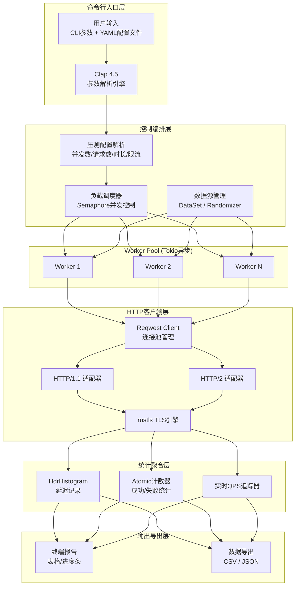
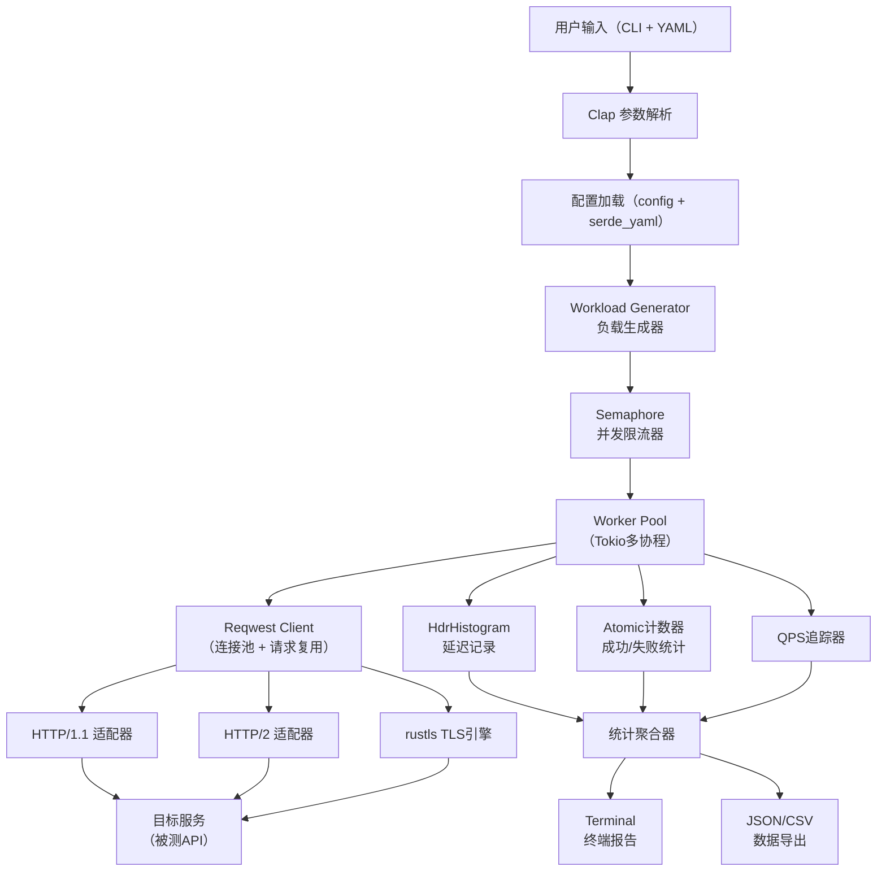

## 第一部分：选题填表

| **类别** | **编号** | **题目** | **限报** | **要求** | **需求概述** | **担任角色** | **建议方案** | **建议语言** | **成果形式** |
|:---:|:---:|:---|:---:|:---:|:---|:---|:---|:---:|:---|
| **Rust和Go高并发架构** | 2 | **Rust HTTP压测工具** | 3 | | 构建高性能HTTP请求发生器和压测工具，实现对目标服务的压力测试与性能评估。支持同步/异步请求生成，自定义请求方法、URL、头信息、请求体；支持HTTP/1.1/HTTP/2协议和HTTPS；支持多并发配置（并发数、总请求数、压测时长）；支持精准QPS限流；支持数据集驱动的随机化压测；输出延迟分布（p50/p95/p99）、QPS、错误率等统计指标。 | 后端、测试、算法 | Reqwest 0.12（HTTP客户端）+ Tokio（异步运行时）+ Hyper（底层HTTP）+ HdrHistogram（延迟统计）+ Clap（CLI解析）+ indicatif（进度条）+ serde（序列化）+ rustls（纯Rust TLS）；支持CSV/JSON结果导出 | Rust | 系统、性能报告 |

## 第二部分：完整设计方案与开发思路

### 一、选题背景与价值定位

在2026年的微服务和分布式系统架构中，HTTP协议已成为所有系统间通信的核心，开发者面临两个核心需求：一是需要好用的HTTP客户端来验证API功能正确性，二是需要压测工具来评估系统在高并发下的表现。传统做法往往要在两套工具之间来回切换——调试用curl/Postman，压测用wrk/ab/JMeter，上下文切换成本高且性能数据不统一。

2026年Rust生态的HTTP压测工具呈现出三大趋势：极致轻量化（如cargo-whero仅22.2KiB）、全场景覆盖（从单次调试到万级并发压测）、精细化统计（支持DNS解析、TCP连接、TTFB各阶段耗时拆解）。本项目的核心价值在于：让学生独立构建一个与如今最前沿的开源压测工具（oha、cargo-whero、lmn等）对标的Rust HTTP压测工具，从零到一完成全链路开发，掌握高并发请求发生、性能统计分析和系统瓶颈定位等核心技能，产出可直接替代wrk/ab用于项目性能测试的专业工具。

### 二、项目学习目标

| 维度 | 具体目标 |
|:---|:---|
| **Rust核心** | 掌握所有权/生命周期；理解Clone/Copy/Debug/Serialize等派生宏的使用场景 |
| **异步编程** | 深入理解Tokio运行时架构（工作窃取调度 + 多线程异步运行时）；掌握async/await的正确用法与性能调优 |
| **网络编程** | 掌握HTTP客户端库（Reqwest）的使用；理解连接池管理、HTTP/2多路复用的原理与收益 |
| **并发模型** | 实现Worker Pool（线程池）模式；掌握Semaphore并发控制与原子操作（Atomic计数器） |
| **性能统计** | 使用HdrHistogram进行高精度延迟分布统计（记录速度达3-6纳秒）；实现百分位数（p50/p95/p99）计算和实时QPS追踪 |
| **CLI工程** | 使用Clap构建现代化命令行界面；实现YAML配置文件支持与参数优先级设计 |

### 三、系统架构设计

### 四、核心功能模块设计

#### 模块1：命令行参数解析（Clap 4.0）
使用`clap`构建类型安全的命令行解析引擎，支持：
- **必选参数**：目标URL
- **并发控制**：`-c, --concurrency`（并发连接数）、`-n, --requests`（总请求数）、`-t, --time`（压测时长）
- **HTTP配置**：`-X, --method`（请求方法）、`-H, --header`（自定义请求头）、`-d, --body`（请求体）、`-f, --file`（从文件读取body）
- **限流配置**：`--rate`（QPS限流）
- **协议配置**：`--http2`（启用HTTP/2）、`--no-tls`（禁用TLS验证）
- **数据集**：`--dataset`（JSON数据集文件路径，实现请求随机化）
- **输出配置**：`--json`（JSON格式输出）、`--csv`（CSV明细导出）

此外支持通过YAML配置文件进行参数配置，实现CLI参数优先于配置文件的优先级设计。

#### 模块2：负载调度与Worker Pool（Tokio + Semaphore）
采用Worker Pool（线程池）模式管理并发请求，避免无限制创建协程导致系统资源耗尽：
- 主任务通过`tokio::spawn`创建协程，使用`Semaphore`限制同时运行的并发数
- 每个Worker独立发送HTTP请求并收集响应数据
- 使用`AtomicUsize`计数器维护已完成请求数、成功数、失败数
- 支持预热模式（Warm-up），丢弃前若干请求结果以消除运行时冷启动影响

#### 模块3：HTTP客户端引擎（Reqwest + Hyper + rustls）
`Reqwest 0.12`底层封装自`Hyper`，提供简洁高层API的同时保留高性能异步能力：
- 支持GET/POST/PUT/DELETE等全量HTTP方法
- 集成连接池管理，复用TCP连接减少握手开销
- 使用`rustls`纯Rust TLS实现，避免OpenSSL的外部依赖
- 支持HTTP/2协议，充分利用多路复用降低延迟
- 实现请求超时、重试机制和自动重定向

#### 模块4：数据集驱动的随机化压测
为避免缓存预热造成的性能假象，支持数据集驱动的随机化压测：
- 读取JSON格式的数据集文件，每条记录包含method、path、body、headers等字段
- Worker通过随机策略从数据集中选取请求参数（可选顺序/随机选择）
- 支持字段值模板化：`{{random.string(8)}}`生成随机用户名、`{{random.int(1,100000)}}`生成随机ID
- 借鉴lmn-core的设计思想，利用JSON模板实现请求参数动态生成

#### 模块5：精准QPS限流（令牌桶算法）
- 实现令牌桶算法进行精确的QPS限流控制
- 令牌桶容量 = QPS/2，填充速率 = QPS tokens/秒
- 每个Worker发送请求前从令牌桶中获取令牌
- 支持按实际发送速率动态自适应调整，确保压测结果符合预期QPS

#### 模块6：性能统计引擎（HdrHistogram + Atomic）
放弃传统浮点数聚合方案，采用**HdrHistogram**，提供纳秒级精度延迟分布（p50/p90/p95/p99/p99.9），并行收集无需加锁：
- 各Worker独立记录延迟值到`HdrHistogram`
- 使用`Atomic`整数维护成功/失败计数器、总字节数、错误码分布
- 实时通过`indicatif`进度条展示RPS和平均延迟
- 完工后执行百分位数聚合计算，生成延迟分布表
- 参考cargo-whero的全维度耗时拆解设计，支持DNS解析、TCP连接、TTFB（首包响应）、完整响应各阶段耗时统计

#### 模块7：报告生成与数据导出
- **终端报告**：汇总总请求数、成功/失败数、错误率、QPS、延迟百分位数（p50/p90/p95/p99/p99.9，纳秒精度内部记录、毫秒展示）、状态码分布（200/4xx/5xx/0=网络错误）、总字节数、错误 TopN
- **JSON输出**：结构化数据供CI/CD解析，含 `latency_ms`（min/mean/max/p50/p90/p95/p99/p99.9）、`status_code_distribution`、`total_bytes` 与每条样本的 `bytes`/`http_version`
- **CSV导出**：汇总表（total/errors/qps/error_rate/min_ms/mean_ms/max_ms/p50_ms/p90_ms/p95_ms/p99_ms/p999_ms/total_bytes）供深度分析存档
- **退出码设计**：可配置性能阈值（如p99<500ms），不达标时退出码为2，便于集成到CI流水线自动判断

### 五、技术架构全景图

### 六、开发路线图（6周/30人日）

| 阶段 | 周期 | 任务 | 输出物 |
|:---|:---|:---|:---|
| **第1周** | 5天 | 项目初始化；学习Tokio异步与Reqwest；搭建CLI框架 | 命令行解析+单次HTTP请求发送 |
| **第2周** | 5天 | Worker Pool实现；Semaphore并发控制；Atomic并发安全计数器 | 多并发压测基础功能完成 |
| **第3周** | 5天 | HdrHistogram延迟统计；百分位数计算；QPS实时追踪 | 性能统计引擎完成 |
| **第4周** | 5天 | 令牌桶QPS限流；数据集随机化压测；自定义请求体 | 高级压测功能完成 |
| **第5周** | 5天 | HTTP/2支持；rustls TLS；JSON/CSV导出；YAML配置 | 全协议支持和数据导出 |
| **第6周** | 5天 | 压测对比测试；性能调优（压测自身性能）；撰写项目报告 | 完整交付+性能验证 |

### 七、测试策略与验证

**单元测试**：
- 使用`cargo test`编写令牌桶限流、HdrHistogram统计逻辑的单元测试
- 使用MockServer模拟目标服务进行集成测试

**基准测试**：
- 使用`criterion.rs`基准测试框架对限流器、统计引擎等核心模块进行微基准测试
- 使用`cargo-criterion`生成可视化基准测试报告

**压力验证**：
- 对比测试本工具与当前主流开源压测工具（oha、wrk、hey）的压测结果一致性
- 验证本工具是否能对目标服务施加稳定的负载，统计数据的准确性与实时性
- 进行压测工具自身的性能测试（即“压测压测工具”），确保本工具在高QPS下自身开销可控

**实施状态（截至 2026-09）**：
- 单元测试：25/25 通过，覆盖 POST 报文、自定义请求头、YAML 合并优先级、状态码分布、纳秒分位数、Semaphore 并发上限、p99 阈值三层合并优先级
- 基准测试：`benches/stats_bench.rs` 覆盖 `Stats::record` 单条写入与 10 万样本 `summarize`；`benches/worker_bench.rs` 覆盖 `TokenBucket::acquire` 在 100/1k/10k/100k QPS 下的开销；`cargo bench --no-run` 已通过编译验证
- 并发模型：`worker.rs` 由"N 个常驻 worker loop"重构为 dispatcher + `tokio::sync::Semaphore` + `tokio::task::JoinSet`；permit 由 spawned task 持有并在结束时 RAII 归还，严格把在途请求数限制在 `--concurrency` 之内；单测验证 in-flight 峰值 ≤ permits
- CI 阈值：`--p99-threshold <ms>` / YAML `p99_threshold_ms` 实现 CLI>YAML>默认 三层合并；`main.rs` 在 reporter 之后比较 `summary.p99_ns/1_000_000` 与阈值，超限以退出码 2 退出

### 八、拓展方向

- **gRPC压测**：集成`tonic`框架实现gRPC协议压测
- **WebSocket压测**：集成`tokio-tungstenite`实现WebSocket连接压测
- **分布式压测**：支持多机协同压测，通过控制节点分发任务、汇聚统计结果
- **OpenTelemetry集成**：导出压测过程中的追踪数据，与Jaeger等链路追踪系统集成
- **可观测性仪表板**：基于Tokio Console构建压测实时监控界面
- **JavaScript/WASM站点压测**：参考`warmer`的设计，使用无头浏览器实现SPA压测